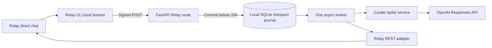

# Curate architecture

## Milestone 1 flow

FastAPI is bound to loopback. The documented CLI signs local forwarded events using
Standard Webhooks. The receiver verifies the unmodified body and its timestamp, validates
the envelope, and normalizes an eligible direct human message into `IncomingMessage`.
The signed event ID must match `webhook-id`. Unsupported/malformed signed payloads are
rejected rather than guessed. Non-message events and non-human/direct chats are ignored.

`IncomingMessage` and `StylistReply` are Pydantic domain models. The stylist knows no Relay
types or methods. It calls `AsyncOpenAI.responses.create` with configurable model, token
limit, timeout, retries, and `store=False`. It receives only the current text message.
Images, tools, wardrobe access, and conversation memory are not yet implemented.

`RelayMessenger` uses HTTPX and the documented `POST /v1/chats/{chatId}/messages` endpoint.
REST avoids installing a Git-sourced Relay Python SDK for a single operation. Provider
request bodies and text rendering live in the adapter. Native UI rendering belongs here
in Milestone 2; deterministic interaction dispatch will precede any GPT reasoning.

## Local delivery reliability

Relay requires acknowledgement within 10 seconds. The receiver commits to a small SQLite
inbox before returning `204`; no network/model work occurs in the request. An inbox error
returns `503`. SQLite writes have a one-second busy timeout. The database is a transport
journal, not a substitute for the planned Supabase product schema.

One background task polls accepted records. It caches a generated reply durably before
sending, then sends with `Idempotency-Key: reply:<event_id>`. A lost network response retries
the same body/key. A unique event ID and a unique `(agent_id, message_id)` prevent duplicate
processing. Pending rows and cached replies survive restarts. An interruption during GPT
generation can repeat a billable model call; outgoing replies remain idempotent. This is
at-least-once processing, not a claim of exactly-once external execution.

Worker attempts are bounded, with exponential backoff. The OpenAI SDK separately retries
transient API failures. Exhausted generation produces an explicit failure reply. Terminal
Relay 4xx responses (except 429) and exhausted sends stay failed in the journal. Logs use
event IDs, source, and exception classes, without private message text/provider bodies.
`/readyz` reports queue counts and local configuration; successful configuration does not
prove a working Relay or OpenAI account.

Run one Uvicorn process, one worker, and one Relay listener per agent. Multiple processes
are intentionally unsupported. SQLite operations run on the owning event-loop thread;
they are small local transactions. Supabase-backed jobs or additional concurrency should
be considered only if later workloads need them.

## Privacy and future boundaries

The journal stores verified sender IDs, agent IDs, chat IDs, text, and replies. Files are
private locally (`.runtime` created with mode 700; database mode 600) and Git-ignored.
Replies always target the verified event's chat. No cross-user conversation state is shared.
`store=False` disables Responses retrieval storage; it is not a claim of zero API retention.

Milestone 3 adds stable internal users mapped to Relay identities and Supabase services.
Product records and private storage will be scoped to those internal IDs. Future wardrobe,
preferences, outfit planning, and media services must remain independent of Relay. The
future stylist can call these services as tools; a Next.js interface can reuse them.
Photo consent, storage policies, deletion, upload validation, and migrations are explicitly
deferred to their assigned milestones, not stubbed as working features.

## Contract references

Relay webhook version `2026-08-30` and API `v1` were checked against the official
[HTTP OpenAPI contract](https://docs.relayapp.im/api-reference/openapi.mint.yaml) and
[message event](https://docs.relayapp.im/events/message-received) on October 7, 2026.
The CLI used for local forwarding is pinned to `relaymessenger@0.1.22`; its implementation
acknowledges only after the local POST succeeds. The OpenAI model identifier `gpt-6-luna`
is documented at [OpenAI](https://developers.openai.com/api/docs/models/gpt-6-luna).
Changing contract versions requires verifying the official docs and fixtures first.
